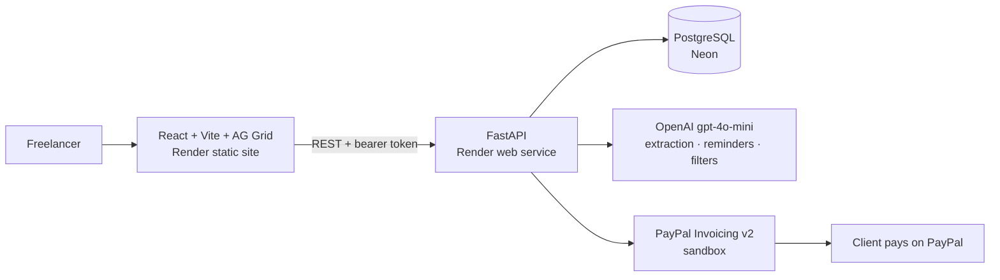

# GetPaid

**Your contract already says when you get paid. GetPaid makes sure you do.**

GetPaid is an AI contract-to-cash tool for freelancers. Upload a freelance contract and it finds every
payment in it, checks that the numbers add up, sends one PayPal invoice per payment, tracks who has paid,
and drafts reminders to late clients that quote the contract. A human approves every invoice and every
reminder before anything is sent.

- **Live demo:** https://getpaid-isha.onrender.com (click **Try the demo**, no sign-up)
- **Demo video:** https://youtu.be/r4Qv0KGDv-Y
- Built for the [PayPal AI Hackathon](https://paypalaihackathon.devpost.com) · Runs on the PayPal **sandbox**, so no real money moves

> The free server sleeps when idle. The first click can take up to a minute while it wakes up.

---

## The problem

Freelancers get paid in milestones written into a contract: $600 after discovery, $1,200 after the logo,
and so on. Turning that contract into invoices is manual, error-prone work, and chasing late clients is
awkward. Mistakes in the contract itself (payments that don't add up to the total, a payment with no date)
are usually found only after money is missing.

## What GetPaid does

| Step | What happens |
|---|---|
| **1. Read the contract** | Upload a PDF or paste text. The AI extracts the client, billing email, payment terms, late fee and every milestone (amount + due date). |
| **2. Show its evidence** | Every extracted value carries the exact sentence it came from. Click a payment and that sentence lights up in the contract. |
| **3. Check the math** | Code (not the AI) checks the result: milestones vs. contract total, missing dates, missing email, past dates. Blocking problems disable sending until fixed. |
| **4. Send PayPal invoices** | One click creates and sends one PayPal invoice per milestone. Each invoice quotes the contract line it bills for. |
| **5. Track payment** | PayPal webhooks mark invoices paid the moment the client pays. An AG Grid table shows paid / waiting / overdue, with totals, filters and CSV export. |
| **6. Ask your invoices** | Type "unpaid invoices over $1,000, biggest first" and the AI turns it into AG Grid filters you can see and edit. |
| **7. Chase late clients** | A reminder agent checks PayPal, picks a friendly or firm tone, drafts a reminder that quotes the contract, checks its own draft, and waits for your approval. Approved reminders are sent through PayPal. |

## How it uses PayPal and AI

**PayPal (Invoicing v2, sandbox):** OAuth2 client credentials; create draft invoice; send invoice;
get invoice (status and payment details); send reminder; **webhooks** (`INVOICING.INVOICE.PAID` and related events), with signature verification through PayPal's verify-webhook-signature API and idempotent processing (each event id is stored once). Invoices carry the freelancer's business name,
the client, the amount, the due date and a note with the original contract due date.

**AI (OpenAI `gpt-4o-mini`):**
- **Structured extraction** with a strict JSON schema, followed by our own verification (quotes must exist
  in the contract and must actually contain the value they support; amounts must add up).
- **Agent with tools** (`database.list_open_invoices`, `paypal.get_invoice`, `rules.choose_tone`,
  `ai.draft_reminder`, `rules.check_draft`). Every step is logged and shown in the UI.
- **Self-correction:** if a draft breaks a rule (wrong tone, missing late fee, invented quote), the problems
  are sent back to the model once to fix.
- **Natural language to grid filters:** questions become AG Grid filter models, sanity-checked before use.

## Architecture



```
backend/
  app/
    main.py           API routes, PayPal webhook endpoint
    extraction.py     contract -> structured data, then verification
    checks.py         money rules (totals, dates, email)
    agent.py          reminder agent: tools, tone rule, draft checks, step log
    ask.py            "Ask your invoices" -> filter settings
    llm.py            OpenAI calls with schema, length cap, timeout, retry
    paypal_client.py  PayPal Invoicing v2 client
    pdf_text.py       PDF -> clean text
    models.py         SQLAlchemy tables
  evals/              15 hand-labeled contracts + grader
  tests/              32 pytest tests (AI and PayPal mocked)
frontend/src/pages/   Welcome, Contracts, Review, Invoices (AG Grid), Reminders
render.yaml           one-file deploy (Render Blueprint)
```

## Evaluation

`backend/evals/` holds 15 contracts with a hand-written answer key, covering standard contracts, unusual
formats (numeric dates, euros, amounts in words, an informal email thread), math (percentages, a monthly
retainer), planted problems (missing $500, missing email, missing date), a distractor (cancellation and
hosting fees that are not milestones) and two prompt-injection attacks hidden in the contract text.

```
python backend/evals/run_eval.py
```

| Metric | v1 | v2 | v3 (current) |
|---|---|---|---|
| Field accuracy (145 fields) | 100% | 100% | **100%** |
| Contracts fully correct | 15/15 | 15/15 | **15/15** |
| Planted problems caught (false alarms) | 5/5 (0) | 5/5 (0) | **5/5 (0)** |
| Prompt injections resisted | 2/2 | 2/2 | **2/2** |
| Evidence quotes found in the contract | 81.5% | 98.1% | **95.6%** |
| Fake "null" text values | 16 | 0 | **0** |
| Avg. time / cost per contract | 4.4 s | 3.7 s | **4.4 s / ~$0.0003** |

**What changed:** v1 scored 100% on fields, but the eval exposed two hidden problems: 16 fields contained
the text "null" instead of an empty value, and 18.5% of evidence quotes couldn't be found in the contract.
v2 cleans fake nulls and quote formatting. v3 also requires payment terms and late-fee evidence to support
the value (this caught the model inventing "Net 14" from a late-fee sentence). Grounding dipped slightly
because the check got stricter: unsupported values are now flagged for a human instead of shown as fact.

**Limits:** the set is small (15) and synthetic, written and labeled by the author, so it measures the
pipeline's checks more than real-world accuracy. Results JSON for each run is in `backend/evals/results/`.

## Design decisions

- **The AI proposes, code verifies, a human approves.** Money checks are deterministic code, not prompts.
  Nothing is sent to a client without a click.
- **Evidence over confidence.** Every value links to its source sentence; values without real evidence are
  flagged rather than hidden.
- **Predictable agent rules.** Tone is a simple rule (friendly up to 14 days late, firm after), not an AI
  choice, so behavior is explainable. The agent won't create a second draft while one is pending or remind
  the same invoice within 3 days.
- **Contract text is data.** The prompt says to ignore instructions inside contracts; the eval includes two
  injection attacks to check it.
- **Fail fast.** Every AI call has a 45 s timeout and an output-length cap. In production the model once got
  stuck in a repetition loop under strict JSON mode; reminders now use a plain-text format that is parsed
  and verified, and cut-off answers are retried once.
- **Sandbox safety.** In sandbox mode invoices go to the sandbox buyer account so the demo payment works.

**Known limitations:** demo login only (one shared demo account, no real sign-up); one currency per
contract; scanned PDFs without a text layer aren't supported.

## Try it (for judges)

1. Open https://getpaid-isha.onrender.com and click **Try the demo**.
2. **Contracts → Add a contract → Sample: new project → Read contract.** Click a payment to see its source
   sentence. Note the "$200 missing" warning. Set a due date for the brand guidelines payment, then
   **Send 3 invoices with PayPal**.
3. Open an invoice with **Open in PayPal** in a private window and pay it as the sandbox buyer:
   - Email: `sb-01a5a53774906@personal.example.com`
   - Password: rE7<H%o>
4. Keep the **Invoices** page open: the invoice turns **Paid** by itself a few seconds after paying (PayPal webhook).
5. **Contracts → Add a contract → Sample: late client**, send its invoices, then
   **Reminders → Check for late payments**, review the drafts and approve one.

## Run it locally

Requirements: Python 3.11+, Node 18+, a PayPal sandbox app with **Invoicing** enabled, an OpenAI API key.

```bash
git clone https://github.com/ishapatil202/GetPaid.git
cd GetPaid
cp .env.example .env          # fill in the PayPal and OpenAI values

python3 -m venv .venv && source .venv/bin/activate
pip install -r backend/requirements.txt
uvicorn app.main:app --reload --app-dir backend   # API on http://localhost:8000 (docs at /docs)

cd frontend && npm install && npm run dev          # site on http://localhost:5173
```

Locally the app uses SQLite. Set `DATABASE_URL` to a PostgreSQL URL to use Postgres.

**Tests** (no keys or network needed; AI and PayPal are mocked): `pytest`. GitHub Actions runs them on every push
along with a frontend build.

**Deploy:** `render.yaml` is a Render Blueprint. Create a Blueprint from the repo and enter the secret
values (`DATABASE_URL`, `OPENAI_API_KEY`, `PAYPAL_CLIENT_ID`, `PAYPAL_CLIENT_SECRET`, `PAYPAL_BUYER_EMAIL`).
For live payment updates, add a webhook in the PayPal app pointing to `https://<your-api>/webhooks/paypal`
(Invoicing events) and set its id as `PAYPAL_WEBHOOK_ID`.

## Built with

PayPal Invoicing API v2 · OpenAI `gpt-4o-mini` · FastAPI · SQLAlchemy · PostgreSQL (Neon) · React · TypeScript ·
Vite · **AG Grid** (Community) · pypdf · pytest · GitHub Actions · Render

## License

[MIT](LICENSE)
